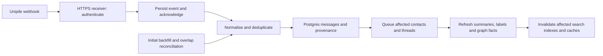

# Unipile: live trial assessment

Date: 2 October 2026. Scope: V1, three existing user-connected accounts. Recommendation: continue a bounded pilot, prioritising LinkedIn and WhatsApp. The evidence supports technical feasibility, not yet a full migration or a claim of lower account-ban risk.

## 1. What was actually tested

Read-only requests using the locally configured credential. No sends, profile visits, account changes, webhook registrations or production imports. Credentials and message bodies were neither logged nor saved.

The measured sample run began at 2026-10-01 22:55:37 UTC (2 October in Sydney). Account listing took 1.429 seconds and returned LinkedIn, Outlook and WhatsApp; all reported source statuses were OK.

| Channel | Sample | First page | Second page | Result |
|---|---:|---:|---:|---|
| LinkedIn | 2 × 5 messages | 0.347 s | 0.343 s | HTTP 200, disjoint page IDs |
| Outlook | 2 × 5 emails | 2.356 s | 1.383 s | HTTP 200, disjoint page IDs |
| WhatsApp | 2 × 5 messages | 0.525 s | 0.534 s | HTTP 200, disjoint page IDs |

These are single observations, not medians, throughput measurements or end-to-end search timings. V1 messaging can serve already-synchronised data; fast reads do not establish fast provider ingestion.

First-page field checks:

- LinkedIn and WhatsApp: 5/5 had message/provider/chat identifiers, timestamp, sender, direction flag and text. Each page contained one outgoing and four incoming messages.
- Outlook: 5/5 had body, date, sender, recipients, thread ID and message ID. **0/5 had a populated body_plain field**, so HTML-to-text conversion remains necessary.
- Attachment fields existed; their presence does not establish attachment availability or successful downloads.
- Pagination worked. Identity persistence across reconnects and matching these IDs to the existing database remain untested.

Local reproducibility artifacts: `ironman/tmp/unipile_probe.py` and `ironman/tmp/unipile-probe-2026-10-02.json`. The latter stores only schema, counts, status and timing. It does not contain account IDs or communication content.

## 2. Functional coverage and product value

### Live webhook follow-up: three-channel success

After explicit user authorization of the temporary Cloudflare relay, three account-scoped V1 webhooks were registered. An isolated loopback receiver validates a dedicated secret and account allowlist, commits events to local SQLite before acknowledging, deduplicates by account/event/message identity, and fetches message details asynchronously. It does not write to the production database. Local synthetic checks passed for missing-secret rejection, unknown-account rejection, and duplicate delivery producing one stored event. The public endpoint also returned the expected 401 and 403 rejection responses.

The user then sent one test message on each channel. Results on 2 October 2026:

| Channel | Receiver arrival, Sydney time | Message timestamp to webhook | Detail fetch | Outcome |
|---|---|---:|---:|---|
| LinkedIn | 11:41:52.943 | 0.818 s | 1.389 s | Body present in webhook; detail GET 200, body present |
| WhatsApp | 11:41:56.022 | 1.022 s | 1.384 s | Body present in webhook; detail GET 200, body present |
| Outlook | 11:42:11.388 | 8.388 s | 1.727 s | Body present in webhook; detail GET 200, body present |

All three contained the test text, and each had one observed delivery at inspection. No attachments were reported for these three new messages. These are one observation per channel, measured from provider message timestamps to this computer's receiver clock, not provider-only latency, a percentile benchmark or an SLA. This establishes live delivery and subsequent detail retrieval; it does not establish disconnect recovery, provider retry behavior or webhook delivery of attachments.

The earlier Outlook attachment test separately downloaded `Eva_Ng_Research_Abstract.pdf`: HTTP 200, 28,016 bytes, SHA-256 identical to the local Downloads file. Its metadata reported 28,288 bytes; consumers should not treat that size as authoritative.

Trial artifacts are under `ironman/tmp/unipile-webhook-trial/`; payloads and registration secrets are local-only and must not be committed/shared. The trial was configured to delete its own three webhooks and stop the tunnel at approximately 13:40 Sydney time; successful automatic cleanup must be verified after expiry rather than assumed.

Follow-up spot check at 2026-10-01 23:03:26 UTC: all three channels returned a message older than each of 30, 180 and 365 days, with returned timestamps checked against the requested threshold. These nine bounded existence checks establish that some year-old history is accessible; they do not measure completeness or the oldest available record. The webhook-list API returned HTTP 200, zero configured webhooks and no next cursor. No live webhook delivery or recovery was tested. Sanitized results: `ironman/tmp/unipile-history-2026-10-02.json`.

The official matrix covers messages, chats, participants, attachments and account/message events for the two messaging channels; email folders and calendars are also supported. This is materially broader than basic inbox ingestion, but individual capabilities still need acceptance tests. [Feature matrix](https://developer.unipile.com/docs/list-provider-features)

LinkedIn profile retrieval documents experience, education, skills and other sections. This could improve organisation, career and capability evidence in the graph. Availability depends on the profile and access context. Profile statements must remain attributed claims, not proof of delivery quality, availability, trust or decision-making authority. No contact enrichment was performed in this trial. [Profile retrieval](https://developer.unipile.com/docs/retrieving-users)

Unipile supplies source data and connection infrastructure. Our identity review, relationship scopes, provenance, capability interpretation, strategy retrieval and graph views still belong to the application. More source data does not by itself create a reliable strategic answer.

Do not infer complete lifetime history from the green feature matrix or from this 30-item sample. Historical retrieval is paginated; the documented default of 100 is a page size. The history-sync endpoint can initiate work despite using GET, and was deliberately not invoked in this read-only probe. [Message retrieval](https://developer.unipile.com/docs/get-messages) · [History-sync endpoint](https://developer.unipile.com/reference/chatscontroller_syncchathistory)

## 3. Security and account restrictions are different questions

Unipile explicitly says email/calendar use official APIs, while LinkedIn and WhatsApp use reverse engineering. Buying a managed connector does not turn those connections into officially approved provider APIs. [Official API explanation, FAQ 08](https://www.unipile.com/pricing-api/)

LinkedIn warns that third-party automation can violate its rules and cause restrictions. Unipile's own provider guidance also describes account restrictions and constrained operations. There is no comparative ban-rate evidence in this trial. We cannot responsibly promise either zero bans or a quantified improvement over the current connectors. [LinkedIn policy](https://www.linkedin.com/help/linkedin/answer/a1340567/automated-activity-on-linkedin?lang=en) · [Unipile restrictions](https://developer.unipile.com/docs/provider-limits-and-restrictions)

The vendor claims SOC 2 Type II, encryption and security controls; its audit report was not independently reviewed here. V1 messaging content, conversations and participants are retained until account deletion according to its privacy policy. The app being local therefore does not mean communication processing is exclusively local. Security marketing's EU-only language should be reconciled with the policy's proxy/subprocessor disclosures before wider adoption. [Security](https://www.unipile.com/security-compliance/) · [Privacy](https://www.unipile.com/privacy-policy/)

## 4. Technical fit with the existing architecture

The current application already has a useful boundary: `adapters/envelope.py` normalises vendor data before `adapters/store_writer.py` persists it. Unipile can fit behind that boundary. Current LinkedIn browser/export handling and WhatsApp's Baileys bridge are the strongest candidates for reduced maintenance; Outlook already uses Microsoft Graph, so its incremental value is smaller.

Integration work that still matters:

1. Preserve canonical message and thread IDs across old and new ingestion paths. Outlook currently keys on internetMessageId. Unipile supplied message_id in the sample, but exact equivalence must be checked against known local records before migration.
2. Resolve chat participants and group context; message-list sender fields alone do not fill the full Envelope. Preserve WhatsApp phone/LID distinctions and LinkedIn provider identity mappings.
3. Keep account ownership and installation boundaries explicit. Existing uniqueness is `(channel, external_id)`, which should not silently become a shared multi-user store.
4. Preserve heuristic identity suggestions as suggestions. Richer profiles are not authorization to merge people automatically.
5. Keep provider failure/reconnect handling, checkpoints, reconciliation and deletion policy in our adapter design.

These are code-based engineering conclusions, not capabilities claimed to have been implemented today. A connector substitution also does not fix the previously observed 77-second strategy request: graph retrieval, database round trips, context construction and model latency remain separate work.

## 5. Webhooks: valuable, but not a complete sync strategy

V1 supports message and email notifications for incoming and outgoing activity. Initial old messages are not emitted as new-message webhooks. Direction must be determined from the sender/account fields rather than interpreting the event name literally. [Message events](https://developer.unipile.com/docs/new-messages-webhook) · [Email events](https://developer.unipile.com/docs/new-emails-webhook)

V1 documents authentication via a custom secret header, a 200 response within 30 seconds and five retries. This is distinct from V2's signed payload mechanism; do not mix versions. [V1 webhook contract](https://developer.unipile.com/docs/webhooks-2) · [V2 webhook contract](https://developer.unipile.com/v2.0/docs/configure-a-webhook)

Proposed integration, not deployed:

The receiver should acknowledge after durable event storage, not after an LLM finishes. Batch bursts by affected contact/thread. Version derived facts and keep source evidence; new messages should not erase manually confirmed labels or silently promote tentative relationships. Handle edits/deletions and out-of-order events explicitly.

A laptop-only application cannot receive events while offline. For an initial local pilot, overlap polling is a supported option; a reachable HTTPS receiver enables webhook delivery while online. A durable hosted relay can bridge offline periods, but adds another data processor and operating cost. A tunnel alone does not provide offline queuing. Retain reconciliation even with webhooks because finite retries cannot guarantee indefinite delivery. [Polling and overlap guidance](https://developer.unipile.com/docs/get-messages)

## 6. Cost economics

Published monthly examples, assuming each person connects exactly three accounts:

| People | Connected accounts | EUR/month | USD/month |
|---:|---:|---:|---:|
| 1 | 3 | 49 | 55 |
| 2 | 6 | 49 | 55 |
| 3 | 9 | 49 | 55 |
| 5 | 15 | 75 | 82.50 |
| 10 | 30 | 150 | 165 |

Prices exclude applicable tax; USD is not AUD. Billing is based on peak simultaneous linked accounts, not contact count or message count. No per-request/message surcharge is advertised. The 51–200-account EUR table and worked example disagree, so confirm that tier before committing. [Pricing](https://www.unipile.com/pricing-api/)

Engineering interpretation: a larger address book does not itself raise this subscription, but raises local storage, indexing and AI costs. Compare avoided connector maintenance against subscription + integration amortisation + monitoring/recovery + webhook infrastructure. At a hypothetical EUR50 engineering-hour cost, the EUR49 minimum alone is roughly one hour/month; this is an illustration, not a measured saving. Keeping Outlook native would not lower the bill while already inside the minimum tier.

## 7. Decision and remaining trial gates

Proceed with the trial; defer full replacement. Keep existing production data and native adapters available until migration checks pass. Prioritise LinkedIn/WhatsApp operational value and assess Outlook separately. Keep the adapter interface versioned: V2 is beta and changes retrieval semantics, IDs and routes, so it is not a drop-in update. [Migration architecture](https://developer.unipile.com/v2.0/docs/migration-introduction) · [V2 status](https://developer.unipile.com/v2.0/docs/welcome)

Before a rollout decision, collect:

- Known historical conversations, groups and attachments, checked against native apps; include filed Outlook mail and sent items.
- Webhook receive-to-store latency, duplicate replay, recovery after temporary receiver failure and reconciliation after an offline interval.
- Canonical-ID correspondence and zero duplicate rows when repeating an import in an isolated evaluation database.
- Reconnection behaviour over several days, with explicit owner participation if reconnecting is needed.
- Retention/deletion and subprocessor answers for the actual V1 subscription, plus confirmed billing at expected scale.

No production configuration was changed in this assessment.

## Suggested update to Mark

> I've connected and read-tested LinkedIn, Outlook and WhatsApp through Unipile. All three are working in the initial sample, including pagination. It looks promising for reducing connector maintenance, and webhooks fit our incremental graph-update design. The main caveat is that LinkedIn and WhatsApp still use reverse-engineered access, so I would not claim it removes restriction risk. The current three-account setup is within the EUR49/US$55 monthly minimum. I'm treating this as a successful feasibility check; historical completeness, reconnect recovery and webhook delivery still need validation before replacing our production ingestion.
