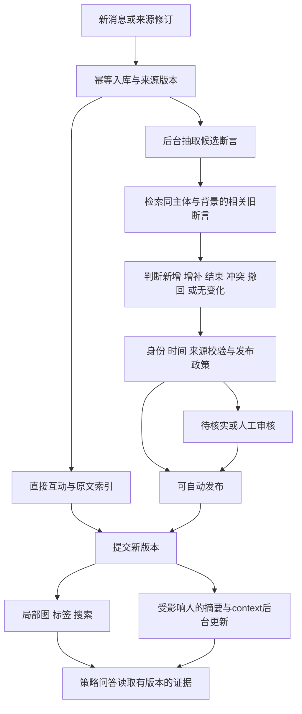

# 持续更新的联系人知识图谱：研究结论与政策建议

> 后续实测更新：已完成 [Graphiti / Neo4j / Postgres 隔离评估](2026-09-29-graphiti-storage-evaluation.md)。它替代第 7 节“优先采用 Graphiti 核心”的试验前偏好：当前建议先做带索引的关系型知识存储，Graphiti 保留适配候选。下文“未安装/未实测”描述的是原调研阶段；本次隔离试验已安装依赖并处理三条虚构消息，未改变生产。

调研日期：2026-09-29。范围：新消息与结构化来源变化如何改变人物、关系、职责、需求和战略画像；如何同步标签、context、summary。仅调研公开一手资料及本仓库代码，未向外部发送私人消息，未安装候选框架、跑模型评测或变更生产。下面的建议是研究后的拟议政策，不代表已经实现或获得产品确认。

## 1. 结论

最接近我们问题的是 **Graphiti/Zep 的时态关系更新**；补充 **Wikidata 的带限定条件断言**、**Hindsight 的事实/摘要/判断分层**，以及 **LightRAG 的来源删除后局部重建**。这是结合不同方法的项目建议，不是某个框架原封不动提供的完整方案。

应先确立一个可审计的知识变化层，再让图、标签、搜索、摘要消费其结果。需要同时解决两种问题：运行层的重复、乱序、崩溃恢复；语义层的主体、否定、任职变更、历史信息、冲突和证据撤回。更换检索算法或图数据库不能替代后者。

## 2. 别人具体怎样做

### Graphiti / Zep：新 episode 与局部旧事实对比，并管理有效期

2025 年论文把原消息、实体关系和群组摘要分层，抽取时结合附近消息。实体使用语义和全文检索寻找候选；事实去重限制在相关实体对。关系分别记录现实有效区间与系统记录/失效时间，发现时间重叠的矛盾后可以使旧边失效并保留历史。论文的失效政策偏向新进入系统的信息，不能直接用于我们乱序导入的历史聊天。[论文 §2](https://arxiv.org/html/2501.13956v1)

**借鉴：**按受影响实体/关系局部查旧事实；两条时间轴；失效与删除分开。**调整：**主体继续由现有 identity resolution 约束；较晚导入不代表较晚生效；“新公司”不必然否定旧公司兼职。源码版本、删除和并发边界见配套研究笔记；不把 2025 论文等同于当前 SDK 每个行为。

源码核对补充：固定版本 `6b4b56f` 的时间比较已有“新导入旧事实自身被后来事件失效”的处理，不能把论文的新信息优先概括为当前代码简单按入库顺序覆盖。另在该版本 remove_episode 中，删边条件使用被删 episode 是否为支持列表首项，并非是否只剩这一项；方法内也未重建存活节点摘要。这是静态审查发现、未运行复现，正是我们需要加入多来源撤回和摘要残留测试的原因。[边更新实现](https://github.com/getzep/graphiti/blob/6b4b56ff6f4b1e4e69c3c3c5487cf1b8762c483a/graphiti_core/utils/maintenance/edge_operations.py#L494)、[删除实现](https://github.com/getzep/graphiti/blob/6b4b56ff6f4b1e4e69c3c3c5487cf1b8762c483a/graphiti_core/graphiti.py#L1676)

### Mem0：把更新建模为明确操作

论文采用候选记忆与相似旧记忆对比，让模型选择 ADD、UPDATE、DELETE 或 NOOP；摘要模块异步刷新。它说明“先检索相关旧知识、再判断变更操作”是可落地路线，不必每条新消息重写整个画像。[论文 §2.1](https://arxiv.org/html/2504.19413v1)

**借鉴：**显式操作以及 NOOP。**调整：**我们把 DELETE 拆成来源撤回、事实纠错、关系结束；商业历史不能统统物理删除。操作应先经过确定性校验，不让模型输出任意数据库写入。

注意版本区别：当前 OSS graph 文档描述额外图后端及 relations 结果；所查 Platform 文档描述原生 entity–memory 共现图，并明确不存 typed manages 等边。它们不能混称为同一个能力，也不能用“提到同一人物”直接代表我们的合作/介绍关系。[OSS 文档](https://docs.mem0.ai/open-source/features/graph-memory)、[Platform 文档](https://github.com/mem0ai/mem0/blob/main/docs/platform/features/graph-memory.mdx)

源码核对补充：固定 HEAD `94c3fe9` 已是 V3 additive 提取/去重路径，不能把上述论文四操作流程称作当前默认实现。历史 graph 的软删除修复已合并，但那个实现重新加入同一关系时会重置有效标记/失效时间，仍不是完整的多段历史。源码与旧 OSS 页面需要按版本读取，本文不推荐安装未发布 HEAD。[当前实现](https://github.com/mem0ai/mem0/blob/94c3fe9f238f3dbf29c9ce98643bd71eb13077cd/mem0/memory/main.py)、[历史修复 PR4188](https://github.com/mem0ai/mem0/pull/4188)

### Wikidata：保留多条带背景的陈述，而非每个字段仅存一个值

其 qualifiers 可以限定时间、角色、方法和视角；rank 管理默认呈现/查询的优先值，reference 指向来源。多个值未必是冲突，rank 也不是来源可信程度或概率置信度。过往正确但现已变化的陈述可通过限定时间保留，而非一概标错误。[Qualifiers](https://www.wikidata.org/wiki/Help:Qualifiers)、[Ranking](https://www.wikidata.org/wiki/Help:Ranking)

**借鉴：**“Alex 负责交付”至少需要说明哪个项目、什么时间、谁提供证据；支持集合与展示优先级分开。我们不需要采用 Wikidata 的公共协作审核流程或 RDF 全栈。

### Hindsight：事实、人物摘要与策略判断分别维护

所读 v1 论文区分 world、experience、observation、opinion；其中 observation 是基于底层事实的人物汇总，相关事实更新后后台重算，opinion 是单独保存的判断。该分离直接对应我们“消息证据—context/summary—谁适合某策略”的不同用途。[论文 §3、§4.1.5](https://arxiv.org/html/2512.12818v1)

**借鉴：**summary/context 是有依赖的派生内容，策略建议单独标推断。**调整：**论文称为 objective 的生成结果仍可能抽错；我们不能因为记录被放入事实层就声称独立核实。本文借鉴论文概念，未验证当前 SDK 的全部实现。

### LightRAG：删除来源后按剩余支持重建

官方文档的文档删除流程包括移除来源片段，删除仅由它支持的实体/关系，对仍有其他文档支持的部分进行重建，并同步向量索引。文档还说明多个存储后端分阶段提交和恢复的边界，不能把多存储自动一致当成无失败保证。[删除和重建文档](https://github.com/HKUDS/LightRAG/blob/main/docs/ProgramingWithCore.md#delete-by-document-id)

**借鉴：**必须存来源→断言→标签/摘要的依赖。删除一封消息，不等于删除这个人或全部关系；保留其他来源能支持的部分。对我们第一阶段单机 SQLite，尽可能把派生图、词法索引和版本发布放在一个事务，降低跨存储恢复复杂度。

### LangMem 与 Microsoft GraphRAG：分别借鉴后台合并与批量索引更新

LangMem 明确区分 collection 与当前 profile，以及请求关键路径和后台提取/合并；同时指出过度抽取降低精确率、抽取不足损失召回。[概念文档](https://langchain-ai.github.io/langmem/concepts/conceptual_guide/)、[后台处理示例](https://github.com/langchain-ai/langmem/blob/main/docs/docs/background_quickstart.md)

Microsoft GraphRAG 当前 CLI 确实有 update 命令，不能沿用“完全不支持增量”的旧说法。但这份 CLI 文档本身没有给出我们的任职冲突、撤回、身份误并和商用画像审核政策；本次没有验证其所有更新源码，不从旧 issue 推断当前删除能力。[官方 CLI](https://microsoft.github.io/graphrag/cli/)

**我们的取舍：**借鉴后台合并；暂不为了消息更新引入全局 community 摘要重建。以后需要跨全网络主题分析时再评估这一层。

### W3C PROV：给依赖与失效一个明确表达

PROV-O 描述来源派生、归属、生成与失效等关系，适合指导“这个结果来自哪些来源、通过什么活动产生”的记录方式。标准不是冲突裁决算法，也不要求我们采用图数据库。[PROV-O](https://www.w3.org/TR/prov-o/)

## 3. 对上一版设计的修正建议

### 3.1 不用单个 status 承担所有语义

拟议记录至少拆成以下独立维度。它们是本项目根据以上资料作出的设计，不是直接复制某篇论文的 schema：

| 维度 | 用途 | 示例 |
|---|---|---|
| 命题与背景 | 谁与谁/什么对象，在什么范围下是什么关系 | Alex — role: delivery lead — Project A |
| 来源与说话人 | 谁说的，原文在哪里，是否转述/引用 | Alex 自述；第三方邮件提及 |
| 认识性质 | 原始观察、来源声称、模型推断 | 收到消息 / 自述任职 / 可能是引荐人 |
| 审核状态 | 是否经人或规则审核 | pending / accepted / rejected |
| 现实有效时间 | 事情何时成立 | valid_from / valid_to，允许未知 |
| 系统记录时间 | 我们何时获知/修订这一版本 | recorded_from / recorded_to |
| 支持与争议 | 仍有效的支持与反对证据 | 两个来源支持；一个待查冲突 |

这样 accepted 的过往任职不会误显示为当前职务；自述的能力也不会变成独立核实的能力。“有原文可引用”和“命题真实”必须分开。

### 3.2 对不同关系采用不同更新规则

| 类别 | 默认变化策略（建议） |
|---|---|
| 实际互动 | 幂等累计观察事件，按查询时间计算频率/衰减 |
| 历史经历/介绍事件 | 增补历史记录，不因最近没提及而抹掉 |
| 当前项目职责/任职 | 比较同主体、同背景和重叠时间；明确变更才结束/取代 |
| 多公司/多项目/多技能 | 允许多值；新增一个值通常不是旧值的反证 |
| 当前需求、预算、可用性 | 保存适用时间与最后核实时间；超出适用范围标待核实，未知不自动视为结束 |
| 能力、决策权限、引荐意愿 | 保留来源性质与明确证据，推断不升级为已核实事实 |
| 策略推荐、候选团队 | 绑定目标和证据版本的临时分析；不会回写为人物永久标签 |

### 3.3 自动化按证据等级推进

我此前提议所有语义变更都 pending，这是保守启动政策，不宜未经评估就当长期交互方式。我们需要既能积累知识，又不让用户逐消息审核。

建议保留三条路径：

1. 直接观察/确定的结构化变更自动发布，注明来源；不推导额外语义。
2. 明确、主体已解析的自述，先在影子模式验证；以后可允许作为“自述、未人工核实”的来源陈述自动可查，资格与 accepted 事实分开。上线阈值按盲评的精确率/错误代价确定，不用模型自报 0.9 作为依据。初期不自动扩大既有 confirmed 标签规则。
3. 身份歧义、相互矛盾、旧关系终止，以及能力/权限等高影响推断进入去重审核队列；用户重点处理这些变化。

第二条是研究后的待确认扩展，与当前“语义候选不进正式标签”的保守基线不同。需要单独决定 UI 标记、搜索资格和验收标准，不能调研完就悄悄启用。

## 4. 我们的具体更新路径（建议）

关键约束：更新判定只读取相关旧断言及必要上下文；原消息仍是依据，旧摘要仅辅助定位。依赖改变后使受影响标签、摘要和回答缓存失效。正式图和标签基于同版本的有效断言；brief 可以稍后就绪，但必须显示覆盖时间。

例子：9月1日 Alex 表示“负责 A 的交付”；9月20日明确表示“Sam 从9月15日起接手”。我们9月25日才导入第二封邮件。变化的有效时间是9月15日，获知时间是9月25日；确认身份与变更后，当前职责转给 Sam，Alex 的历史记录保留。9月26日重放9月1日邮件，不应把负责人改回 Alex。若只有“Sam 加入了项目”，则不能推断 Alex 已退出。

## 5. 怎样证明更新策略可靠

LongMemEval 将 knowledge updates、temporal reasoning、abstention 等分开评估，适合借用任务分类。但它主要是聊天记忆问答，不直接测我们的第三方人物图、merge/reverse、来源删除和业务标签；论文总 QA 分不能替代生产正确性评测。[论文](https://arxiv.org/abs/2410.10813)、[官方数据与评估代码](https://github.com/xiaowu0162/LongMemEval)

建议建立固定事件流测试集，在每一步保存期望图变化和可回答问题，而不是只测最终答案。至少覆盖：

- 无变化、等价增补、新事实、多值并存、明确结束、冲突、撤回；
- 主动发信、同名不同人、转述、否定、条件性意向、需求误当能力；
- 历史补录、乱序到达、重复转发、来源更正与删除、merge/reverse；
- 模型处理中又有新消息、重启重放、多来源中撤回一个、摘要滞后。

比较基线：只追加；直接覆盖最新；带证据/时间/关系类型的变更政策；可选 Graphiti 适配器。尽量固定抽取模型和输入预算，分离更新政策收益与更强模型收益。

指标：变更操作精确率/召回率、错误主体绑定率、错误使旧事实失效率、当前/历史状态正确率、无依据正式标签率、撤回残留率、每百条消息的审核条目数、每批更新的模型成本，以及入库到图/摘要可见的 P50/P95。QA 与策略推荐质量另列，不混成一个总分。

这里给出的是评估设计，没有执行数据集、跑 benchmark 或证明任一阈值达标。Mark 的 24,222 条历史消息可作规模参考，不能拿其他系统的延迟百分比推断本地效果。

## 6. 采用与不采用

建议采用 Graphiti 的局部时态更新思路、Wikidata 的带背景陈述、Hindsight 的派生摘要分层、LightRAG 的依赖撤回。先在现有 Python/Postgres 来源与本地派生 store 边界实现和测量，不立刻换整套存储。

Graphiti 是值得加入隔离对照实验的实现候选；是否直接集成取决于真实 schema 映射、身份解析兼容、来源撤回语义、并发恢复、模型/embedding 配置与成本。当前不能仅凭论文或产品名称决定替换架构。

Microsoft GraphRAG 可留作后续全局主题/群组摘要路线；当前主要问题是联系人状态变化与证据可靠性。商业策略判断始终保留自己的目标、依赖和不确定性，不把推荐结果当作下一次更新的事实来源。

配套源码核对：[Graphiti / Mem0 研究笔记](../research_notes/2026-09-29-kg-update-systems.md)。原有设计与实施计划仍为待实施状态；本报告提供后续修订依据，不代表新增政策已获批准。

## 7. 后续选型问题：是否直接采用 Graphiti

Eva 提问后于 2026-09-29 再核实：Graphiti 使用 Apache-2.0，属于可自托管的开源框架；Zep 是另一个产品边界，不能把其托管平台、专有引擎或服务性能视为 Graphiti OSS 已包含的能力。[许可证](https://github.com/getzep/graphiti/blob/main/LICENSE)、[官方定位](https://github.com/getzep/graphiti#graphiti-and-zep)

当前 latest release 页面指向 v0.30.2。若进入验证，锁定发布版本并记录 commit/依赖；前文对 HEAD 的代码审查发现不能直接宣称为 v0.30.2 已复现问题。[发布页](https://github.com/getzep/graphiti/releases/tag/v0.30.2)

### 推荐方向（评估意见，未执行迁移）

提升 Graphiti 为生产图谱核心的优先验证候选，暂缓自研完整的时间失效、实体/关系语义去重和混合检索引擎。保留我们已有的采集、canonical identity/merge-reverse、四层关系业务定义、证据审核和产品 UI。这样可复用基础引擎，而应用继续拥有接受什么知识以及怎样展示的政策。

候选架构：现有 Postgres 消息/身份来源 → 持久化增量任务及身份映射适配器 → Graphiti 与独立本地图存储 → 应用断言审核/有效性政策 → 共享图、标签和检索服务 → 异步 summary/context 与策略问答。Graphiti 的底层候选存储可以早于人工审核，但用户可见查询必须经过政策过滤；默认 Graphiti search 不能绕过 pending/hidden/source-deletion 限制。

| 路线 | 判断 |
|---|---|
| 完全自研全部图谱基础设施 | 控制力强，但需要自己维护语义去重、时态检索和演进；当前不优先投入这些通用部分 |
| Graphiti 作为核心，应用适配与政策单独维护 | 优先做有限验证；有望减少通用代码，同时保留业务语义和可逆身份解析 |
| 整个 Comms 应用替换成 Graphiti/Zep | Graphiti 不是完整 Inbox/CRM，不解决我们的采集/业务 UI；不作为当前迁移方案 |

Python 版本要求与当前项目有交集；依赖实际共存尚未安装验证。官方提供 Neo4j/FalkorDB 等后端，当前源 Postgres 不直接变成其现成图后端。候选部署可采用独立本地 Neo4j Docker；原消息数据库仍为来源，图库作为派生存储。[依赖声明](https://github.com/getzep/graphiti/blob/main/pyproject.toml)、[安装文档](https://github.com/getzep/graphiti#installation)

AnthropicClient 可以接现有商业 API。LLM、embedder、cross_encoder 是独立组件；构造器缺省后两者使用 OpenAI 客户端，不能仅传 Anthropic 就宣称完全沿用一个供应商。验证时必须显式配置全部模型路径；优先评估本地 embedding/reranker，运行资源与多语言质量另测。不开启未选择供应商的数据发送。[Anthropic 实现](https://github.com/getzep/graphiti/blob/main/graphiti_core/llm_client/anthropic_client.py)、[构造器](https://github.com/getzep/graphiti/blob/main/graphiti_core/graphiti.py)

### 有限验证的具体通过条件

建议先使用虚构事件流覆盖以下六个硬条件，再在隔离环境以约 20–30 联系人、300–500 消息的真实授权样本验证（这是建议样本规模，不是统计保证）：

1. 已知 canonical IDs 保持稳定；同名不同人不误并，merge/reverse 可正确重映射。
2. 职责交接和乱序历史导入保持正确当前/历史状态，允许多公司/多项目并存。
3. 删除任一支持、最后一个支持后，图、标签、摘要与检索均无错误残留；保留其他有效支持。
4. pending、hidden、被撤回来源及非当前事实不能穿透到未加限定的业务推荐。
5. 断线、重复任务、崩溃恢复和重建不改变审核结果；可从源库重建派生图。
6. 分别记录初始构建、新消息处理、搜索、回答的时间/成本/资源，以及对接与修补所需代码量；不用供应商 sub-second 宣传替代本机实测。

如果适配能够通过这些条件且维护量合理，采用 Graphiti 核心；若必须长期 fork 大量内部失效/身份代码，重新比较自有断言层的成本。无需在验证前永久绑定数据库或框架。本节没有批准安装依赖、全量导入或生产切换。
